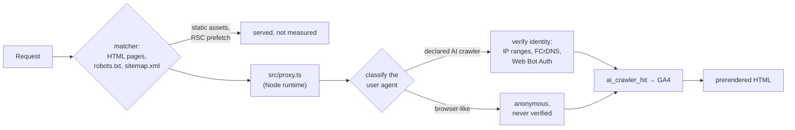
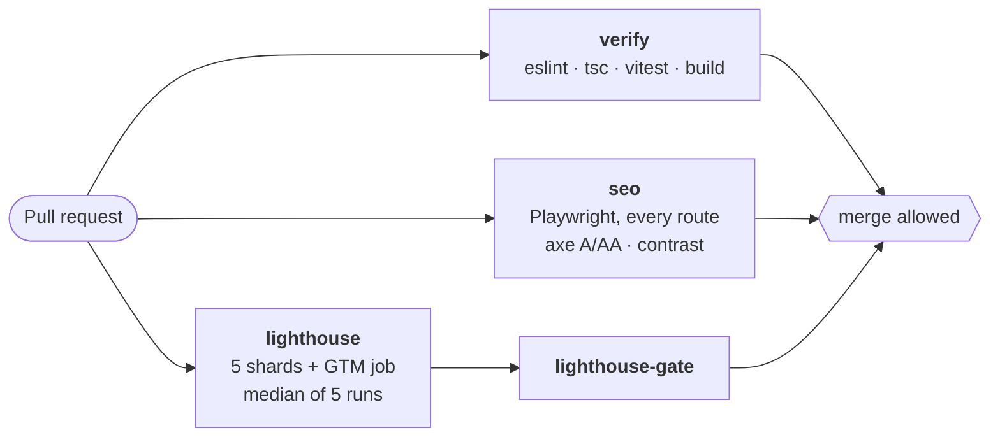

# SEO Técnico — seotecnico.dev.br

[](https://github.com/Alf4kill/seotecnico.dev.br/actions/workflows/ci.yml)

A live, public **technical SEO laboratory**: Portuguese-first content and free
web tools focused on technical SEO for developers who build modern websites,
with Next.js as the reference implementation. The site itself is
the experiment — every technique documented here is implemented on this very
domain and measured there: Search Console exports, lab runs, the site's own
field data (RUM in GA4) and its request logs.

Built and maintained by Nalpi — technical SEO engineer.

## What to open first

Three links, in the order that answers "is any of this real?".

1. **[Case studies](https://seotecnico.dev.br/en/case-studies)** — changes made
   on this domain, each with the problem, what was done and the measurement
   that closed it. Every fact is checkable in this repository, and no claim
   rests on a number the code or the log does not support.
2. **[`docs/ai-workflow.md`](./docs/ai-workflow.md)** — the site is built with
   Claude Code, and this says how: who decides what, which rules the CI refuses
   to let through, and every number next to the command that reproduces it.
   Nothing in it is a number I typed by hand.
3. **[`.github/workflows/ci.yml`](./.github/workflows/ci.yml)** and a
   [run of it](https://github.com/Alf4kill/seotecnico.dev.br/actions/workflows/ci.yml?query=branch%3Amain)
   — the four gates below, and the comments explaining the two times they were
   green and wrong.

Five audits of real third-party sites, collected from the outside with no
Search Console access, became published articles — anonymised, with counts
rounded by the collecting script itself:
[soft 404](https://seotecnico.dev.br/en/blog/soft-404),
[sitemap audit](https://seotecnico.dev.br/en/blog/sitemap-audit),
[raw vs rendered HTML](https://seotecnico.dev.br/en/blog/raw-vs-rendered-html),
[index bloat](https://seotecnico.dev.br/en/blog/index-bloat) and
[one page per keyword](https://seotecnico.dev.br/en/blog/one-page-per-keyword).
The five scripts that collected them take any domain, respect `robots.txt` and
round third-party counts themselves:
[`audits/case-studies/README.md`](./audits/case-studies/README.md).

At commit `21e2df1` (2026-11-18): 698 commits, 162 merged pull requests, 67 MDX
pages paired across Portuguese and English, 88 routes in the sitemap, five
layers of tests. `npm run history:numbers` reprints the history half of that
line from `git log`, so it is never stale by more than the last commit.

## Stack

- [Next.js](https://nextjs.org/) (App Router) + TypeScript
- Tailwind CSS
- MDX content in `/content` (no CMS)
- Hosted on Vercel

## How it works

Every page is prerendered. The one thing that runs per request is
[`src/proxy.ts`](./src/proxy.ts), and it only measures: it classifies the
request, writes one `ai_crawler_hit` event, and always returns
`NextResponse.next()`. It never blocks, rewrites or redirects — a crawler sees
exactly what a browser sees.



Why it exists: a crawler does not run JavaScript, so GTM — and therefore all of
GA4 — is structurally blind to it, and Vercel Hobby drops function logs after
about an hour. The request itself is the only window.

Four gates guard `main`. They run in parallel on every pull request, including
stacked ones, and three check names are what branch protection requires.



## Development

Node version is pinned in [`.nvmrc`](./.nvmrc) — `nvm use` picks it up, and CI
reads the same file.

```bash
npm install
npm run dev     # local dev server
npm run build   # production build (all routes SSG)
npm run lint    # eslint
```

Copy `.env.example` to `.env.local` for local configuration. The site defaults
to `noindex` unless `SITE_INDEXABLE=true` is set (production fail-safe).

## Testing

Four gates guard `main`, and every one of them runs locally.

```bash
npm test        # vitest — unit tests for /lib and the API routes, component tests for the tools
npm run lint    # eslint
npx tsc --noEmit
```

The SEO regression suite and the performance budgets both audit the **built**
site, so they need a production build first — and that build needs two
environment variables set explicitly:

```bash
NEXT_PUBLIC_DOMAIN=https://seotecnico.dev.br SITE_INDEXABLE=true npm run build
NEXT_PUBLIC_DOMAIN=https://seotecnico.dev.br SITE_INDEXABLE=true npm run test:seo
npm run lhci
```

<details>
<summary><strong>Both variables are needed on both commands</strong> — and getting it wrong does not fail loudly</summary>

The build bakes them into the HTML, and the suite reads them again to know what
to assert.

- **`NEXT_PUBLIC_DOMAIN`** — a local `.env.local` typically points it at
  `http://localhost:3000`, which Next bakes into every canonical and OG URL at
  build time. Playwright does not read `.env.local`, so the suite falls back to
  the production domain and every canonical assertion fails on a mismatch that
  exists only in the local build.
- **`SITE_INDEXABLE`** — without it the build emits `noindex` everywhere (the
  fail-safe above). Missing it at build time fails the suite; missing it at
  *test* time is worse — the noindex assertion and the robots.txt crawler-policy
  test skip themselves, and the run goes green having checked less than it
  looks.

The suite runs against `next start` on port 3100 and Lighthouse on 3200, both
deliberately off 3000 so a dev server is never audited by mistake.

</details>

What the SEO suite asserts, per route enumerated from `app/sitemap.ts`: exactly
one `<h1>`, title and description within length limits, a self-referencing
canonical, JSON-LD that parses with the expected `@type` set, and reciprocal
hreflang pairs. New articles are covered the moment their MDX file lands.

### Quality: what each layer covers

| Tool | Command | Covers |
|------|---------|--------|
| Vitest | `npm test` | Pure logic in `/lib` and the API routes (coverage floor in `vitest.config.ts`) |
| Vitest + React Testing Library | `npm test` | The three tool UIs: queried by role and label, driven with `user-event`, APIs mocked |
| Playwright | `npm run test:seo` | SEO invariants per route, theme and contrast by colour role, analytics events, search |
| axe-core + Playwright | `npm run test:a11y` | WCAG 2.0/2.1 A and AA on every route, both themes, tools after producing a result |
| Lighthouse CI | `npm run lhci` | Performance budgets on pull requests (`lighthouserc.js`) |

`test:a11y` is a subset of `test:seo` (same build, same env variables) and runs
with it in CI. **No axe rule is disabled, but `color-contrast` is a warning,
not a failure**: this site has its own visual identity, so a colour change is a
design decision taken after seeing the finding, not one the CI imposes. The
findings are grouped by colour pair in `test-results/a11y-report.md`, in the
CI job summary and as `::warning::` annotations on the pull request. Contrast
by colour role stays a blocking gate in `tests/seo/contrast.spec.ts`. Every
other axe rule fails the build. Results: [`docs/a11y-test-report.md`](./docs/a11y-test-report.md).

## Licensing

- **Code** — [MIT](./LICENSE). Learn from it, reuse it, adapt it.
- **Content** — articles and guides in [`/content`](./content), images, and
  original data visualizations are **all rights reserved**
  ([details](./content/LICENSE.md)). Short quotes with attribution and a link
  to the original are welcome; republishing is not.

## Project reference

See [CLAUDE.md](./CLAUDE.md) for the full project spec: objectives, site
architecture, SEO requirements, measurement plan, and roadmap.
